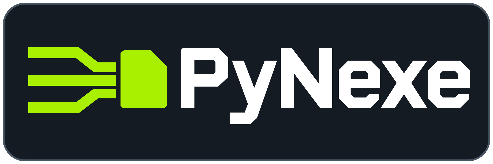

<p align="center">
  
</p>

<p align="center">Builds a standalone Windows executable from a Python project, driven by a single <code>config.yaml</code>.</p>

<p align="center">
  
  
  
</p>

## Setup

**Requirements:** Python 3.13+ and, to build, Windows 10/11 with Visual Studio Build Tools.

On macOS and Linux you can edit configs and run `info`. `run` only warns and then fails.

```bash
git clone https://github.com/kodezy/pynexe.git
cd pynexe
pip install -r requirements.txt
python pynexe.py help
```

## Config

Copy [`config.yaml`](config.yaml) into the folder of the project you want to build and edit it.

```yaml
project_name: "my_app"
main_file: "main.py"
output_name: "my_app.exe"

project_libs:
  - "requests"

include_packages:
  - "src"

include_data_dirs:
  - "assets=assets"

icon_file: "icon.ico"

windows_metadata:
  product_name: "My Application"
  file_description: "My Python Application"
  product_version: "1.0.0.0"
  file_version: "1.0.0.0"
  copyright: "My Company"
  company_name: "My Company"
```

| Key | Required | Description |
|-----|----------|-------------|
| `project_name` | yes | Name used for the build folders |
| `main_file` | yes | Entry script |
| `output_name` | yes | Executable file name |
| `project_libs` | no | Packages your project needs, installed in the build environment |
| `include_packages` | no | Local packages to include in the executable |
| `include_data_dirs` | no | Data folders as `source=destination` |
| `icon_file` | no | `.ico` file for the executable |
| `windows_metadata` | no | Product, version, copyright, and company properties |
| `build_libs` | no | Build tools installed in the build environment; defaults to `nuitka` and `ordered-set` |
| `nuitka_plugins` | no | Nuitka plugins; defaults to `upx`, `no-qt`, and `tk-inter` |
| `nuitka_extra_args` | no | Extra Nuitka arguments; defaults to `--lto=no`, `--show-scons`, and `--jobs=1` |
| `cleanup_items` | no | Extra paths to delete after the build |

Paths resolve against the current directory, not the config file's folder.

## Usage

Run these from the project folder that holds your `config.yaml` and `main_file`.

```bash
python pynexe.py info
python pynexe.py run
python pynexe.py run --config production.yaml
```

- `info` shows the settings and whether each file exists. It builds nothing.
- `run` builds the executable and writes `output_name`.
- `--config` selects another config file.

The build runs in a temporary virtual environment with only `build_libs` and `project_libs` installed.

**`run` deletes paths in the current directory** after the build: `<project_name>.build`, `<project_name>.dist`, `<project_name>.onefile-build`, `__pycache__`, and every `cleanup_items` entry. Run it in a disposable project folder.

## Architecture

```text
pynexe.py        # Entry point
src/
├── cli.py       # Commands, file validation, and output
└── builder.py   # Config loading, build environment, and Nuitka
```

`cli.py` calls `builder.py`, which has no console output of its own.

## Limits

- Antivirus software may flag the executable. Nuitka output and UPX compression often trigger heuristics. Add an exception, report a false positive, or sign the executable.
- A failed Nuitka build usually means Visual Studio Build Tools are missing.
- A missing module at runtime usually means it is absent from `project_libs`.

## Development

```bash
pip install ruff
ruff check .
```

There is no test suite. [AGENTS.md](AGENTS.md) maps the repository for coding agents.

## License

[MIT](LICENSE)
